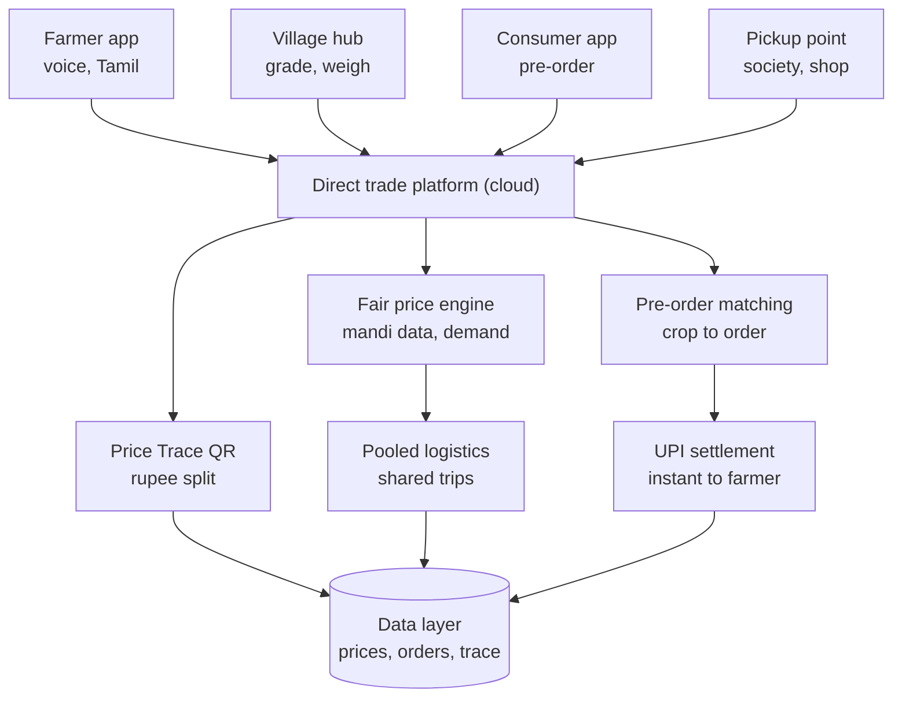

# Smart India Hackathon Workshop

**Date:** 24 November 2026
**Reference Number:** 26017238
**Name:** Krishna Prasath P

## Problem Title
SIH 26033: Multiple intermediaries reduce farmers earnings and increase consumer prices.

## Problem Creator's Organization
Ministry of Consumer Affairs, Food & Public Distribution

## Theme
Agriculture, FoodTech & Rural Development

## Problem Description
Expected Solution: Create a digital marketplace that:
- Connects farmers/FPOs directly with consumers and bulk buyers.
- Provides logistics support.
- Uses AI for demand forecasting and route optimization.

Benefits:
- Better prices for farmers.
- Lower prices for consumers.
- Reduced supply chain inefficiencies.

---

## Proposed Solution: KisanSetu

KisanSetu is a crop-to-order direct trade platform that links farmers and FPOs with consumers, retailers and bulk buyers, and shows everyone where each rupee goes.

### Detailed explanation
1. **Crop-to-order:** Buyers pre-order produce for the coming harvest. Farmers and FPOs list expected yield, and the platform matches it to demand by crop, location and date.
2. **Fair price engine:** Suggests a price band using public mandi and e-NAM price data plus local demand. The farmer can accept or adjust it.
3. **Village hubs:** FPO centres or local market yards grade and weigh produce, so quality is verified without a middleman.
4. **Pooled logistics:** Orders from the same area are grouped into shared delivery trips with optimized routes.
5. **UPI settlement:** The farmer is paid directly after delivery confirmation; the platform fee is deducted automatically.
6. **Price Trace QR:** Each pack or batch carries a QR code showing the split of the consumer's rupee between farmer, transport, hub and platform fee.

### How it addresses the problem
- Removes commission agents and multiple wholesalers by connecting buyers and sellers directly.
- Pre-orders reduce distress selling and wastage, because demand is known before harvest.
- Pooled routes lower transport cost per kg, which allows lower consumer prices and higher farmer share.
- Price transparency gives farmers bargaining power and builds consumer trust.

### Innovation and uniqueness
- Crop-to-order planning instead of a plain "list and wait" marketplace.
- Price Trace QR makes the farmer's share of the final price visible to the consumer.
- Shared delivery trips by locality, supported by village hubs for grading.
- Voice-first Tamil and English interface for farmers with low digital literacy.

---

## Technical Approach

### Architecture diagram

### Technologies
| Layer | Technology |
|---|---|
| Frontend | React (web), React Native (mobile) |
| Backend | Python FastAPI or Java Spring Boot |
| Database | PostgreSQL |
| AI / ML | Python, scikit-learn / Prophet for demand and price forecasting |
| Route optimization | Google OR-Tools, OpenStreetMap routing |
| Payments | UPI gateway (e.g. Razorpay) |
| Language support | Tamil and English, speech-to-text for voice input |
| QR generation | Python `qrcode` library |

### Methodology and process
1. Farmer registers (directly or through an FPO) and lists crop, quantity and expected harvest date.
2. Platform shows the suggested price band from the fair price engine.
3. Consumers and bulk buyers pre-order; the matching module allocates orders to listings.
4. At harvest, the village hub grades and weighs the produce and confirms quantity and quality.
5. Route optimizer groups orders by area and creates shared delivery trips.
6. Buyer receives produce and confirms; UPI payment is released to the farmer.
7. Price Trace QR on each batch shows the rupee split.
8. Order and price history feed back into the demand forecasting model.

---

## Feasibility and Viability

### Analysis
- Mandi price data is publicly available (Agmarknet, e-NAM), and UPI is widely used even in rural areas.
- FPOs and existing market yards can act as hubs, so no new heavy infrastructure is needed.
- Revenue is a small fixed fee per order, far lower than typical intermediary margins.
- Pilot plan: one district, 2 to 3 crops, one consumer cluster; then expand.

### Potential challenges and risks
- Low digital literacy and trust among farmers.
- Quality disputes between farmer and buyer.
- Perishability and delivery delays.
- Poor connectivity in villages.
- Initial lack of buyers on the platform.

### Strategies to overcome them
- Voice-first Tamil interface; onboarding through FPOs and village volunteers.
- Hub-based grading with photo evidence and a simple dispute flow.
- Short routes, pre-orders and pooled trips to limit spoilage.
- Offline-first app that syncs when connectivity returns.
- Start with community buyers (housing societies, hostels, small retailers) to build demand early.

---

## Impact and Benefits

### Potential impact on the target audience
- **Farmers/FPOs:** higher share of the final price, quicker payment, less wastage.
- **Consumers:** fresher produce at lower prices, with traceable pricing.
- **Bulk buyers:** predictable supply at transparent rates.

### Benefits
- **Economic:** higher farmer income, lower retail price, smaller supply chain margins.
- **Social:** more trust and bargaining power for small farmers; rural employment at hubs and in delivery.
- **Environmental:** less food waste and fewer wasteful delivery trips through pooled routing.
- **Metrics:** farmer's share of consumer rupee, price gap versus retail, wastage percentage, repeat orders.

---

## Research and References
- e-NAM (National Agriculture Market): https://enam.gov.in
- Agmarknet (mandi price data): https://agmarknet.gov.in
- ONDC (Open Network for Digital Commerce): https://ondc.org
- Tamil Nadu Uzhavar Sandhai (farmers' markets) initiative
- Google OR-Tools (vehicle routing): https://developers.google.com/optimization/routing
- NITI Aayog and Ministry of Agriculture publications on supply chain margins and FPOs
